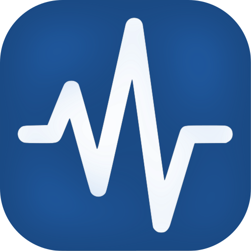
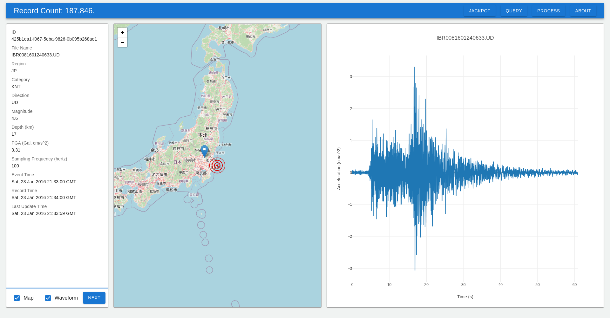

<p align="center">
  
</p>

<h1 align="center">motion-base</h1>

<p align="center">
  <strong>A unified gateway to strong-motion records.</strong><br>
  Search, download, process, and analyze earthquake ground motions from national databases — through one modern web interface and one typed async Python client.
</p>

<p align="center">
  <a href="https://github.com/TLCFEM/motion-base/actions/workflows/master.yml"></a>
  <a href="https://codecov.io/gh/TLCFEM/motion-base"></a>
  <a href="https://hub.docker.com/r/tlcfem/motion-base"></a>
  <a href="https://hub.docker.com/r/tlcfem/motion-base"></a>
  <a href="LICENSE"></a>
</p>

<p align="center">
  <a href="https://tlcfem.top/mb/"><strong>Live Demo</strong></a> ·
  <a href="docs/README.md"><strong>Documentation</strong></a> ·
  <a href="docs/Architecture.md"><strong>Architecture</strong></a> ·
  <a href="docs/Search.md"><strong>Search API</strong></a> ·
  <a href="docs/PythonClient.md"><strong>Python Client</strong></a> ·
  <a href="#-deploy-your-own"><strong>Deploy</strong></a>
</p>

[](https://tlcfem.top/mb/)

Ground-motion records are scattered across national databases, each with its own format, interface, and access model.
`motion-base` ingests raw archives, normalizes metadata into one schema, indexes everything for fast search, and exposes a consistent API for large-scale research.

## ✨ What you can do

| | |
| --- | --- |
| **🔎 Search without friction** | Filter by region, magnitude, PGA, event/station location, date, station code, direction, or file name, choosing MongoDB for simple queries or Elasticsearch for deep pagination. |
| **🌊 Process on demand** | Upsample, downsample, remove leading samples, normalize, and apply low/high/band-pass/stop filters with selectable windows. |
| **📈 Go beyond waveforms** | Compute FFT spectra and displacement, velocity, and acceleration response spectra with configurable damping and period grids. |
| **🐍 Automate everything** | Use the async Python client to search, bulk download, filter, convert units, and plot records, with every response delivered as clean, machine-readable JSON. |
| **⚙️ Scale it up** | Taskiq workers handle heavy parsing in the background, while Docker Compose and Kubernetes manifests make deployment straightforward. |

## 🚀 Quick start

> Requires `docker`, `curl`, and `jq`.

```bash
curl -s https://raw.githubusercontent.com/TLCFEM/motion-base/refs/heads/master/scripts/example.sh -o example.sh && bash example.sh
```

The script launches the full stack — API, web UI, MongoDB, Elasticsearch, RabbitMQ, and S3-compatible storage — and loads six demo records.
Then open **http://localhost:3000**.

[Watch the walkthrough →](https://asciinema.org/a/FYpQv4PFufAEArqzWBOyodzeQ)

## 🐍 Python client

```bash
git clone https://github.com/TLCFEM/motion-base.git
cd motion-base
pip install .[client]
```

```python
import asyncio

import matplotlib.pyplot as plt

from mb.app.response import PaginationConfig, QueryConfig
from mb.client import MBClient


async def main():
    async with MBClient("https://tlcfem.top/mb/api", timeout=20) as client:
        records = (
            await client.search(
                QueryConfig(
                    min_magnitude=6,
                    min_pga=200,
                    pagination=PaginationConfig(page_size=20),
                )
            )
            or []
        )

        await client.download(records)
        for record in client:
            record.plot_response_spectrum()
        plt.show()


asyncio.run(main())
```

Downloaded records also support filtering, normalizing, unit conversion, spectrum computation, and export to two-column text files.

## 🌍 Supported networks

| Network | Region | Input files |
| --- | --- | --- |
| [NIED / K-NET, KiK-net](https://www.kyoshin.bosai.go.jp/) | Japan | `.EW`, `.NS`, `.UD` |
| [GeoNet / NZSM](https://www.geonet.org.nz/data/types/strong_motion) | New Zealand | `.V1A`, `.V2A` |

Bundled crawlers mirror both archives locally.
Adding another national database only requires a new parser — contributions are welcome.

## 🧱 Under the hood

| Layer | Technology |
| --- | --- |
| Web UI | SolidJS, Leaflet, Plotly, TanStack Table |
| API | FastAPI, Pydantic |
| Storage | MongoDB for records, Elasticsearch for search and aggregations, S3-compatible cache |
| Background jobs | Taskiq with RabbitMQ |
| Signal processing | NumPy, SciPy, numba, Pint |

## 📦 Deploy your own

Production Compose, an nginx reverse-proxy variant, and Kubernetes manifests live in [`docker/`](docker/).
Multi-arch images are published to Docker Hub (`tlcfem/motion-base:{front,back,crawler}`) and GHCR, and standalone Linux binaries are attached to each release.

```bash
cd docker
docker compose --env-file .env -f docker-compose-production.yaml up -d
```

Set production secrets and `MB_FS_HOST=seaweedfs` in `docker/.env`, and override the frontend API URL; see [Deployment](docs/Deployment.md) for the full checklist.
For local development, run `python mb_runner.py` for the API and `pnpm dev` inside `gui/` for the frontend.
See [`docs/README.md`](docs/README.md) for the complete documentation index.

## 📚 Documentation

- [Documentation index](docs/README.md)
- [Architecture](docs/Architecture.md)
- [Deployment and local development](docs/Deployment.md)
- [Ingestion and crawlers](docs/Ingestion.md)
- [Search and query API](docs/Search.md)
- [Waveform processing](docs/Processing.md)
- [Python client guide](docs/PythonClient.md)
- [HTTP API reference](docs/API.md)
- [Executable Python notebook](docs/client.ipynb)
- [Live API docs](https://tlcfem.top/mb/api/docs)

## 🤝 Contributing

Collaboration at any level is welcome — new database parsers, processing methods, UI improvements, and documentation.
Open an issue or submit a pull request.

Data downloaded through `motion-base` remains subject to the terms and copyright of the originating network.

## 📄 License

[GNU General Public License v3.0 or later](LICENSE).
