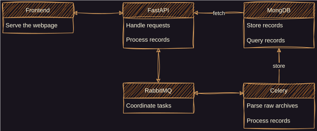

# Architecture

The frontend is a `Solid` application.

The backend is built around six core components:

1. `FastAPI`: HTTP API and orchestration layer.
2. `MongoDB`: primary storage for parsed records and metadata.
3. `Elasticsearch`: search and aggregation engine used by `/search`, `/stats`, and purge/index workflows.
4. `taskiq`: async background workers for expensive and long-running tasks.
5. `RabbitMQ`: message broker for asynchronous task dispatch.
6. Python processing modules: waveform/spectrum processing and parser implementations.

Taskiq uses RabbitMQ as the broker and MongoDB as the result backend. Tasks are defined and executed natively as
async functions, so no synchronous-to-asynchronous event loop bridge is required.

The core services are deployed as separate containers and can be distributed across machines.



## Deployment

The provided production compose file `docker/docker-compose-production.yaml` defines eight services:

1. `mongo`: MongoDB database, also used as the task result backend.
2. `rabbitmq`: message broker.
3. `elasticsearch`: search and aggregation engine.
4. `mb-back`: backend API service.
5. `mb-front`: frontend service.
6. `mb-worker`: taskiq worker(s).
7. `mongo-express`: optional MongoDB admin UI.
8. `seaweedfs`: S3-compatible file cache.

The minimum practical, full-featured setup is `mongo`, `rabbitmq`, `elasticsearch`, and `mb-back` (plus `mb-front` for the web UI).
Adding `mb-worker` improves responsiveness by offloading heavy parsing tasks.

A taskiq worker can be started with:

```bash
taskiq worker mb.taskiq:broker mb.app.jp mb.app.nz
```

The same command is available through the bundled runner:

```bash
python mb_runner.py taskiq
```

For reverse-proxy deployment, see `docker/docker-compose-production-nginx.yaml`.
